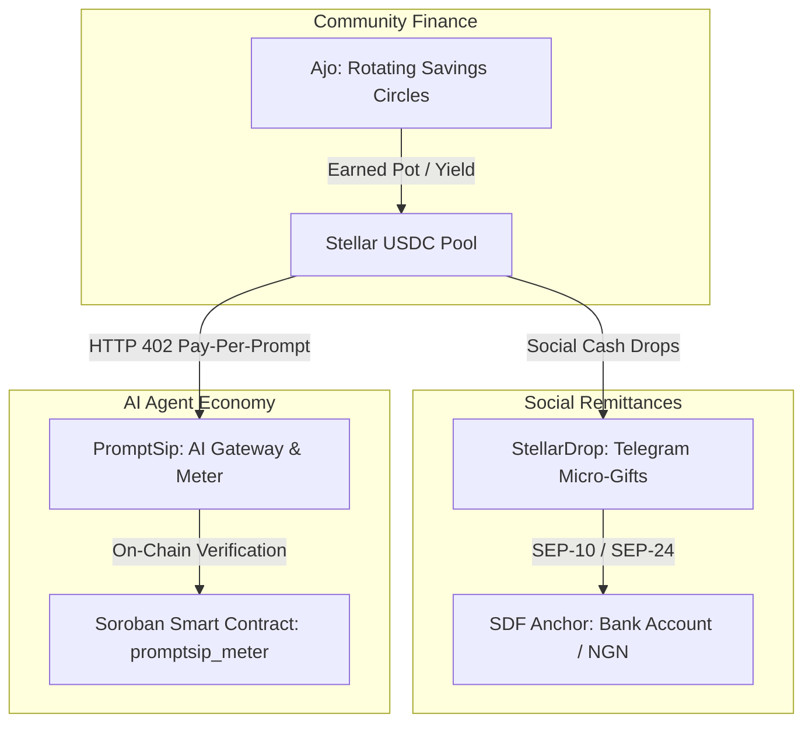

# 🌟 StellarSuite — Boundless Hackathon 2026

> A unified Stellar Web3 platform built by a team of three, uniting **Community Rotating Savings (Ajo)**, **Social Remittances & Telegram Micro-Drops (StellarDrop)**, and **Autonomous AI HTTP 402 Micropayments (PromptSip)** on Stellar & Soroban.

---

## 🏛️ The Three Pillars



---

## 🚀 Live Testnet Deployments & Demos

| Project | Role | Live Deployment / Link |
| :--- | :--- | :--- |
| **Ajo Stellar** | Decentralized Savings (Esusu) | 🌐 [Live Web App](https://ajo-stellar.vercel.app) · [GitHub Repo](https://github.com/Savioula23/ajo-stellar) |
| **PromptSip** | AI Micropayment Gateway | 📜 [StellarExpert Contract Explorer](https://stellar.expert/explorer/testnet/contract/CB2U4ZI42D4NVHUXKG4ZZRAOYESU65QIWY47EZX5HMRQVJMDKAKWAK2N) · [Stellar Lab](https://lab.stellar.org/r/testnet/contract/CB2U4ZI42D4NVHUXKG4ZZRAOYESU65QIWY47EZX5HMRQVJMDKAKWAK2N) |
| **StellarDrop** | Social Remittance & Telegram Bot | 🌐 [Live Web App](https://stellardrop.netlify.app/) · 🤖 [Telegram Bot](https://t.me/ST_dropBot) · [GitHub Repo](https://github.com/jedi-dtechmaker/stellar-hackathon) |

---

## ⚡ PromptSip Soroban Smart Contract Details

- **Contract ID:** `CB2U4ZI42D4NVHUXKG4ZZRAOYESU65QIWY47EZX5HMRQVJMDKAKWAK2N`
- **Network:** Stellar Testnet
- **Payment Asset:** Native XLM SAC (`CDLZFC3SYJYDZT7K67VZ75HPJVIEUVNIXF47ZG2FB2RMQQVU2HHGCYSC`)
- **Admin Address:** `GAMWOYHYZLFCQHNWBRHCJOMLM3S5ZUM2VAW4QQD2GPJJSHML7BSQEY3Q`
- **Deployment TX:** [`9b421221df7ed238...`](https://stellar.expert/explorer/testnet/tx/9b421221df7ed238f996a93e78fadf8c0daa4d5b84d034564dfa438352033c61)
- **Init TX:** [`fce04374a177e723...`](https://stellar.expert/explorer/testnet/tx/fce04374a177e7235eb1255256d371c1263ded684dd978bbb537fd3c93d57dfb)

### Contract Methods:
1. `pay_prompt(payer, prompt_id, model, tokens_used, amount)`: Direct HTTP 402 pay-per-prompt settlement with token transfer & on-chain receipts.
2. `fund_credits(payer, amount)`: Pre-funded micro-credit pool enabling zero-latency AI streaming without waiting for block consensus.
3. `consume_credit(payer, prompt_id, model, tokens_used, amount)`: Settles streaming tokens from payer's balance.
4. `withdraw_credits(payer, amount)`: Refunds unused credits back to payer.
5. `get_prompt(prompt_id)`: Verifies prompt receipts on-chain with replay protection.
6. `get_stats()`: Returns total prompts served & total volume settled.

---

## 👥 Team Members & Contributions

- **official-papi**: PromptSip AI Gateway, Soroban Smart Contract (`promptsip_meter`), and Unified Platform Architecture.
- **Savioula23**: Ajo Rotating Savings Protocol, Soroban contract, Passkey smart-contract accounts, and live frontend.
- **jedi-dtechmaker**: StellarDrop Express API, Telegraf Telegram bot, and SDF Test Anchor SEP-10 / SEP-24 off-ramping.

---

## 🛠️ Local Development

### Web App:
```bash
pnpm install
pnpm run dev
```

### Soroban Smart Contract:
```bash
cd contracts
cargo test        # 3/3 passing tests
stellar contract build
```
